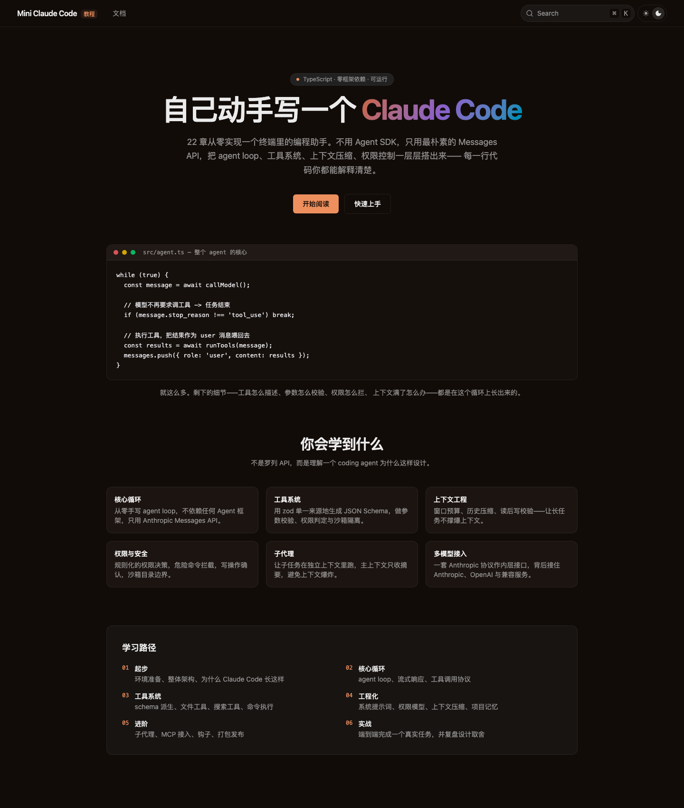

# Mini Claude Code

一个从零手写的终端编程助手（TypeScript），外加一本讲透它是怎么造出来的中文教程。



- **教程站点**：`fumadocs` + Next.js 16，位于仓库根目录
- **示例代码**：`examples/mini-claude-code/`，一个真实可运行的 CLI

不用任何 Agent 框架——不用 Claude Agent SDK，不用 LangChain。示例支持 Anthropic Messages API 与 OpenAI 兼容的 Chat Completions API。

## 目录结构

```
.
├── app/                    # Next.js 站点（fumadocs）
├── components/mdx.tsx      # MDX 组件注册
├── content/docs/           # 教程正文
│   ├── index.mdx
│   ├── getting-started/    # 起步
│   ├── core/               # 核心循环
│   ├── tools/              # 工具系统
│   ├── engineering/        # 工程化
│   ├── advanced/           # 进阶
│   └── practice/           # 实战
├── scripts/                # 文档一致性检查
│   ├── check-links.mjs     # 站内死链检查
│   └── check-snippets.mjs  # 代码片段与源码逐字一致性检查
├── lib/                    # 站点配置
├── examples/
│   └── mini-claude-code/   # 教学实现本体
│       ├── src/
│       │   ├── index.ts        # CLI 入口
│       │   ├── agent.ts        # agent 主循环
│       │   ├── llm.ts          # provider 抽象（mimo / anthropic / openai）
│       │   ├── openai.ts       # OpenAI 兼容适配层（手写 SSE 解析）
│       │   ├── prompt.ts       # 系统提示词
│       │   ├── permissions.ts  # 权限规则
│       │   ├── context.ts      # 上下文管理
│       │   ├── tui.ts          # 终端交互界面
│       │   ├── ui.ts           # 终端颜色与符号
│       │   └── tools/          # 工具实现
│       └── test/tools.test.ts  # 18 个测试用例
└── docs-style-guide.md     # 教程写作规范
```

## 跑教程站点

```bash
pnpm install
pnpm dev
```

打开 http://localhost:3000 。

其他命令：

```bash
pnpm build        # 生产构建
pnpm start        # 启动生产服务
pnpm types:check  # 类型检查
pnpm check        # 链接 + 代码片段一致性检查（CI 跑的就是这条）
```

## 跑示例代码

```bash
cd examples/mini-claude-code
pnpm install
export MIMO_API_KEY=tp-xxx
pnpm start
```

启动后进入终端对话界面：输入消息并按 Enter 发送；方向键上下浏览输入历史，Page Up / Page Down 滚动对话。工具执行需要授权时按 `y` 同意或按 `n` / Enter 拒绝。使用 `/help` 查看命令，`/clear` 清空会话，`/compact` 压缩上下文，`/exit` 退出；请求中按 Ctrl+C 可取消。界面需要支持 TTY 的终端。

也可以使用 OpenAI：

```bash
export LLM_PROVIDER=openai
export OPENAI_API_KEY=sk-xxx
export OPENAI_MODEL=gpt-4.1  # 可选
pnpm start
```

默认使用 MiMo 国内 Token Plan（`mimo-v2.6-flash`）。`MIMO_API_KEY` 使用订阅专属密钥，`MIMO_MODEL` 和 `MIMO_BASE_URL` 可覆盖默认模型与中国区地址；模型名也可写为 `mimo/mimo-v2.6-flash`。在启动目录的 `.env` 中设置变量也可，已有环境变量优先。`LLM_PROVIDER` 支持 `mimo`、`anthropic` 和 `openai`，默认为 `mimo`。使用 Anthropic 时设置 `LLM_PROVIDER=anthropic` 和 `ANTHROPIC_API_KEY`。OpenAI 默认模型为 `gpt-4.1`，可通过 `OPENAI_MODEL` 覆盖；`OPENAI_BASE_URL` 可指定兼容 Chat Completions 的 API 基础地址（例如 `https://example.com/v1`）。自定义服务需要支持流式响应和工具调用。上下文压缩也会使用所选提供商。

跑测试：

```bash
cd examples/mini-claude-code
node --import tsx --test test/tools.test.ts
```

也可以用 Bun 直接跑 TypeScript：

```bash
cd examples/mini-claude-code
bun src/index.ts
```

## 配置模型服务商

示例代码支持三种 provider，通过 `LLM_PROVIDER` 切换：

```bash
# Anthropic
LLM_PROVIDER=anthropic ANTHROPIC_API_KEY=sk-ant-xxx

# OpenAI
LLM_PROVIDER=openai OPENAI_API_KEY=sk-xxx

# OpenAI 兼容服务（默认，MiMo）
MIMO_API_KEY=tp-xxx
```

## 检查文档一致性

```bash
node scripts/check-links.mjs      # 站内死链
node scripts/check-snippets.mjs   # 代码片段与源码逐字比对
```

`check-snippets.mjs` 会把每个 MDX 里带 `title="src/..."` 或 `title="test/..."` 的
代码块去真实源码里找连续子序列，匹配不上就报漂移。这是「代码必须与源码一致」
这条约定的自动化守卫。

## 教程目录

| 章节 | 内容 |
| --- | --- |
| 起步 | 环境准备、架构总览、第一个 agent |
| 核心循环 | agent 循环、流式响应、工具调用协议、多模型接入 |
| 工具系统 | schema 与注册表、文件工具、搜索工具、命令执行、任务清单 |
| 工程化 | 系统提示词、权限模型、上下文管理、项目记忆 |
| 进阶 | 子代理、MCP 接入、钩子、打包发布 |
| 实战 | 端到端完成一个真实任务 |

## 技术栈

- 站点：[fumadocs](https://fumadocs.dev) v16、Next.js 16、React 19、Tailwind CSS 4
- 示例：`@anthropic-ai/sdk` v1、zod v4、TypeScript 5.9

## 许可

MIT

## 安全边界

示例用于教学。Bash 默认需要确认，但可访问工作目录之外；文件路径检查也不能消除并发更换符号链接的竞态。处理不可信任务时请使用容器等操作系统级隔离，并审查每条命令。
